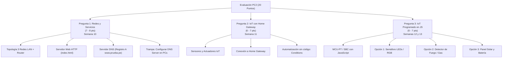
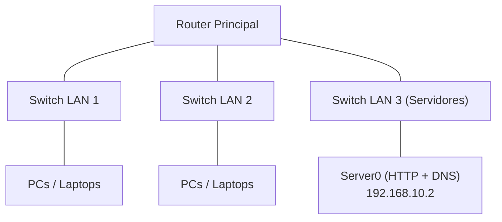
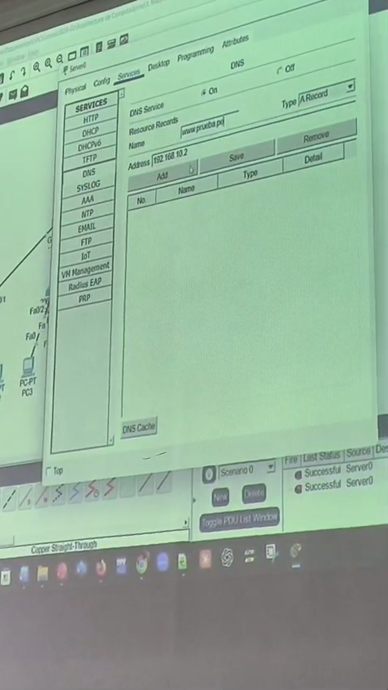
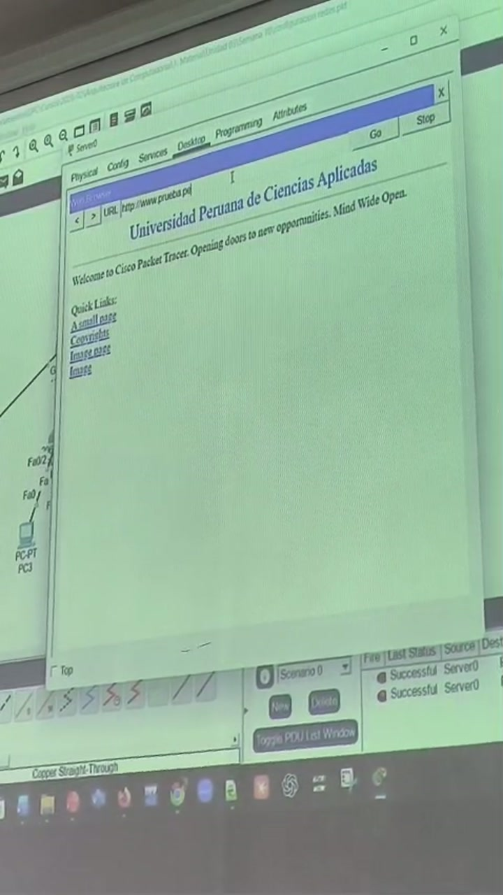
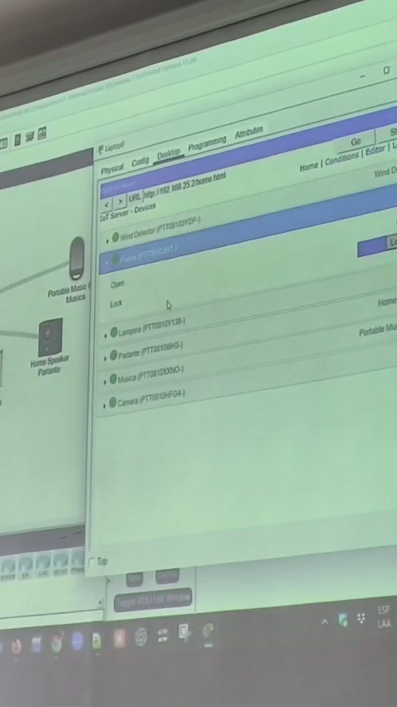
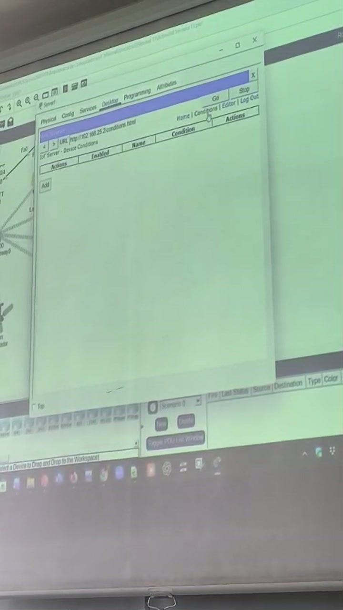
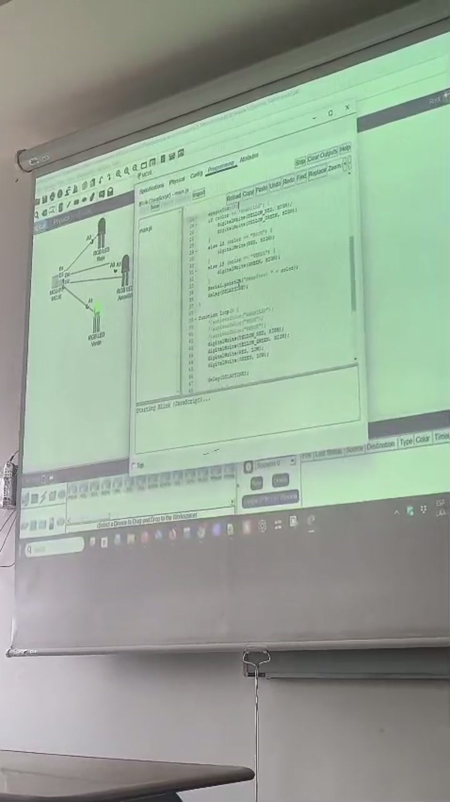
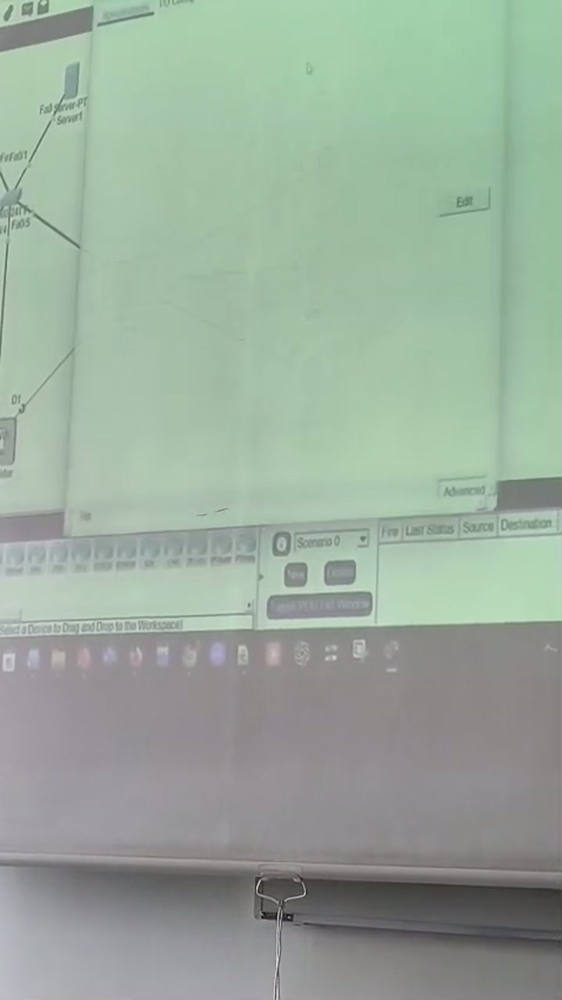

# 🎯 Guía Definitiva para la PC2: Arquitectura de Computadoras (UPC)

> [!IMPORTANT]
> **Confirmación directa del docente:** La PC2 consta exactamente de **3 preguntas** distribuidas en un puntaje aproximado de **7, 7 y 6** (o **8, 8 y 4** para totalizar 20 puntos). El examen se desarrolla íntegramente sobre **Cisco Packet Tracer**.

---

## 📋 Resumen Estructural de la Evaluación



---

## 🌐 Pregunta 1: Redes LAN, Router y Servicios Web / DNS (Semana 10)

### 1. ¿De qué trata?
Implementación de una topología de interconexión con un **Router**, tres **Switches 2960**, computadoras cliente (PCs) y un **Servidor de Servicios (Server0)**.



### 2. Pasos de Configuración en el Servidor (`Server0`)
1. **Configuración IP del Servidor:**
   * Dirección IP estática (ejemplo del video: `192.168.10.2`).
   * Default Gateway: IP de la interfaz del router hacia esa LAN (ej. `192.168.10.1`).
2. **Servicio Web (HTTP):**
   * Ir a la pestaña **Services** > **HTTP**.
   * Activar `HTTP: On` y `HTTPS: On`.
   * Editar el archivo `index.html` (el profesor colocó *"Universidad Peruana de Ciencias Aplicadas"*).
3. **Servicio de Nombres (DNS):**
   * Ir a **Services** > **DNS**.
   * Activar `DNS Service: On`.
   * En **Name**: ingresar el nombre de dominio solicitado (en el video usó `www.prueba.pe`).
   * En **Type**: seleccionar `A Record`.
   * En **Address**: colocar la IP del servidor (`192.168.10.2`).
   * Clic en el botón **Add**.



### 3. La Trampa Clave advertida por el Profesor
> [!WARNING]
> **Atención con el DNS Server en las PCs clientes:**
> Si un alumno solo configura la IP y el Gateway en una PC cliente, podrá navegar por dirección IP (`http://192.168.10.2`), **pero NO podrá resolver el dominio `www.prueba.pe`**.
> 
> Para que resuelva el dominio en cualquier PC de cualquier red:
> * Debes abrir la PC cliente > **Desktop** > **IP Configuration**.
> * En el campo **DNS Server**, escribir obligatoriamente: `192.168.10.2`.



### 4. Diagnóstico de Ping Inicial
* El primer ping suele salir `Failed` debido al proceso de aprendizaje ARP / STP.
* El segundo ping consecutivo debe salir `Successful`.

---

## 🏠 Pregunta 2: Red IoT con Home Gateway y Condiciones (Semana 11)

### 1. ¿De qué trata?
Automatización y supervisión de dispositivos inteligentes **sin escribir código**. Se utilizan reglas condicionales configuradas en el entorno web del Home Gateway.

### 2. Dispositivos Involucrados
* **Concentrador:** Home Gateway (`DLC100`).
* **Sensores / Actuadores:** 
  * Sensor de Viento (`Wind Detector`) o Movimiento (`Motion Sensor`).
  * Ventilador (`Ceiling Fan`).
  * Cámara Web (`Webcam`).
  * Lámpara inteligente (`Light`).
  * Puerta (`Door`).
* **Terminal de Monitoreo:** PC o Laptop conectada a la misma red.



### 3. Pasos de Configuración
1. **Asociación al Home Gateway:**
   * Entrar a cada dispositivo IoT > pestaña **Config** > **Settings**.
   * En la sección **IoT Server**, seleccionar la opción **Home Gateway**.
2. **Acceso al Monitor IoT desde Laptop/PC:**
   * En la Laptop, abrir **Desktop** > **Web Browser**.
   * Navegar a la IP del Home Gateway (por defecto `http://192.168.25.2/home.html` o la que tenga asignada).
   * Iniciar sesión para ver la lista de dispositivos sincronizados.
3. **Creación de Reglas (Conditions):**
   * Ir a la pestaña superior **Conditions** > clic en **[Add]**.
   * Definir un nombre de regla (ej. *Viento_Alarma* o *Cámara_On*).
   * Establecer la condición: `If Wind Detector Status > 10` (o `Motion == true`).
   * Establecer la acción: `Set Fan = On` / `Set Camera = On`.



---

## ⚡ Pregunta 3: IoT Programado en JavaScript (Semanas 12 y 13)

### 1. ¿De qué trata?
Control mediante microcontrolador **MCU-PT** o placa de desarrollo **SBC-PT** programada en **JavaScript** dentro de la pestaña `Programming`.

> [!TIP]
> Si la pestaña `Programming` aparece vacía:
> Haz clic en **New** > Selecciona la plantilla prediseñada (**Template**) para generar la estructura básica de funciones (`setup()` y `loop()`) o **Empty** para escribir desde cero.

El docente repasó tres posibles variantes de laboratorio:

---

### Variante A: Semáforo IoT con LED RGB (Semana 12 - Actividad 2)

El microcontrolador gestiona un semáforo cambiando entre Rojo, Amarillo y Verde con tiempos de espera (`delay`).



**Esquema de conexiones y código base:**
* Pin D5: Rojo
* Pin D4 y D3: Amarillo (o combinación de rojo + verde en RGB)
* Pin D2: Verde

```javascript
// Definición de Pines
var RED = 5;
var YELLOW_RED = 4;
var YELLOW_GREEN = 3;
var GREEN = 2;
var DELAYTIME = 2000;

function setup() {
    pinMode(RED, OUTPUT);
    pinMode(YELLOW_RED, OUTPUT);
    pinMode(YELLOW_GREEN, OUTPUT);
    pinMode(GREEN, OUTPUT);
}

function setColor(color) {
    if (color == "ROJO") {
        digitalWrite(RED, HIGH);
        digitalWrite(YELLOW_RED, LOW);
        digitalWrite(YELLOW_GREEN, LOW);
        digitalWrite(GREEN, LOW);
    } else if (color == "AMARILLO") {
        digitalWrite(RED, LOW);
        digitalWrite(YELLOW_RED, HIGH);
        digitalWrite(YELLOW_GREEN, HIGH);
        digitalWrite(GREEN, LOW);
    } else if (color == "VERDE") {
        digitalWrite(RED, LOW);
        digitalWrite(YELLOW_RED, LOW);
        digitalWrite(YELLOW_GREEN, LOW);
        digitalWrite(GREEN, HIGH);
    }
    Serial.println("Semaforo: " + color);
    delay(DELAYTIME);
}

function loop() {
    setColor("VERDE");
    setColor("AMARILLO");
    setColor("ROJO");
}
```

---

### Variante B: Detector de Fuego / Gas (Semana 12 - Actividad 3)

* **Entrada:** Sensor de Fuego/Humo (`digitalRead(A0)` o `analogRead(A0)`).
* **Salidas:** Sirena de alarma (`Siren`), Aspersor de agua (`Fire Sprinkler`) y pantalla LCD.
* **Lógica:** Si la señal supera el umbral de detección, activar sirena, accionar aspersor e imprimir alerta.

---

### Variante C: Sistema de Energía Solar y Batería (Semana 13 - Actividad 2)

* **Entorno:** Controles ambientales (`Sunlight`).
* **Componentes:** Panel Solar (`Solar Panel`), Batería (`Battery`), Medidor (`Power Meter`) y Motor.
* **Lógica en JavaScript:** La batería calcula el porcentaje de carga almacenada y actualiza su estado/icono.

```javascript
var availablePowerPercent = (availablePower / MAX_STORED_POWER) * 100;

if (availablePowerPercent < 10) {
    setImage('Battery_0');
} else if (availablePowerPercent < 30) {
    setImage('Battery_20');
} else if (availablePowerPercent < 50) {
    setImage('Battery_40');
} else if (availablePowerPercent < 70) {
    setImage('Battery_60');
} else if (availablePowerPercent < 90) {
    setImage('Battery_80');
} else if (availablePowerPercent <= 100) {
    setImage('Battery_100');
}
```



---

## ✅ Checklist Rápido para el Examen

| Paso | Acción en Packet Tracer | Punto Crítico |
| :--- | :--- | :--- |
| **P1.1** | Configurar IPs y Gateways en Router, Switches y PCs | Verificar máscaras de subred (`/24`) |
| **P1.2** | Configurar Servidor HTTP y editar `index.html` | Encender el servicio (`On`) |
| **P1.3** | Configurar Servidor DNS con registro A (`www.prueba.pe`) | Encender el servicio (`On`) |
| **P1.4** | **Poner la IP del DNS Server en cada PC cliente** | **¡Obligatorio para que resuelva el nombre!** |
| **P2.1** | Conectar sensores/actuadores al Home Gateway | Modo de servidor: `Home Gateway` |
| **P2.2** | Crear reglas en la pestaña `Conditions` del navegador | Probar la interacción cambiando el estado del sensor |
| **P3.1** | Conectar pines del MCU a los actuadores (LEDs / Motores) | Respetar numeración de pines digitales `D0..D5` |
| **P3.2** | Escribir lógica JavaScript en la pestaña `Programming` | Clic en `Run` para verificar que compile y ejecute |
